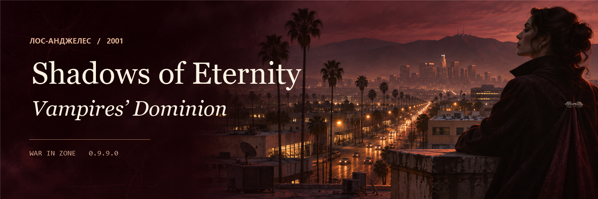

<h1 align="center">Shadows of Eternity: Vampires’ Dominion</h1>

Лос-Анджелес, 2001 год. Шесть вампирских кланов, Бесклановые, две организации охотников и Общество Оборотней делят власть над городом. Возглавьте одну из восьми игровых фракций.

<strong>Windows</strong> · WAR IN ZONE <strong>0.9.9.0</strong> · Первая публичная тестовая версия

<a href="#install">Как установить</a> · <a href="#features">Что добавляет мод</a> · <a href="#stories">Сюжет и события</a> · <a href="#city">Районы города</a>

## Как установить

1. Скачайте [ZIP с модом v0.1.0](https://github.com/Perkybanana/Shadows-of-Eternity-Vampires-Dominion/releases/download/v0.1.0/Shadows-of-Eternity-Vampires-Dominion-v0.1.0.zip). Полностью распакуйте его в отдельную папку вне игры, например `D:\Mods\Dominion`. После распаковки оставьте около **2 ГБ** свободного места.
2. Запустите **`Install-SoEVD.exe`** и выберите **`WAR IN ZONE.exe`** из установленной игры версии **0.9.9.0**. Установщик соберёт рядом отдельную папку `Vampires-Dominion`.
3. Закройте ранее запущенную WAR IN ZONE. Откройте **`Vampires-Dominion\Play-SoEVD.exe`**. Для следующих запусков используйте этот же файл.
4. Начните новую игру. В разделе модов выберите **Shadows of Eternity: Vampires’ Dominion — 2001**, затем фракцию.

Сохранения мода находятся в **`Документы\SoEVD-Vampires-Dominion\saves`**. Чтобы удалить мод, закройте игру и удалите папку, в которую распаковали релиз. Профиль с партиями хранится отдельно.

## Что добавляет мод

- **87 территорий одного города.** Больницы, клубы и мастерские уже работают на карте. Удерживая университетскую лабораторию, фракция получает ночное стекло, а токарный цех в квартале автомастерской даёт пружинную полосу. Такие мастерские переходят вместе с районом. Снести их или построить второй экземпляр нельзя.
- **Кровь, набор и обращение.** Для вампиров кровь служит и пищей, и лекарством. Люди и оборотни питаются продуктами и лечатся медикаментами, а кровью могут торговать. Новичков дают залы призывов. В школах один приказ повышает одного рекрута на следующую ступень. Вампиры также могут обратить человека за 4 единицы крови и 1 командное очко, затем нужно ждать четыре хода.
- **Клановая экипировка и зачарование.** Десять особых материалов связывают мастерские, торговлю и улучшение оружия. Серебряную нить можно потратить на оборону квартала, вплести в плащ или раскатать в фольгу. В мистической библиотеке оружие и реагент обмениваются на зачарованный экземпляр. Клановые заклинания доступны только своему клану, а их три ступени соответствуют опытному бойцу, ветерану и мастеру.
- **Десять фракционных поставщиков и три независимых торговца.** Внешний рынок продаёт обычное снабжение. Вера Лейн держит броню и материалы, Оскар Финч — улучшенное метательное оружие и детали. Селия Нокс платит за малую партию наркотиков 4 500 против 3 500 на внешнем рынке. Доступ к каждому независимому торговцу даёт контроль над его кварталом.
- **Дипломатия Креста и Летифер.** Инквизиция начинает в войне с пятью вампирскими кланами, но сохраняет хрупкий мир с Ангелус, Крестом и оборотнями. На экране дипломатии Крест может предложить двум противникам перемирие. Каждый отвечает в свой ход, для мира нужны обе подписи. Летифер созывают союзников на совет. Первый отказ нейтрального клана от поддержанного требования ведёт к бойкоту на четыре хода. Повторный отказ после бойкота может начать войну.
- **Боевые трофеи и облик фракций.** После боёв с Бесклановыми остаются талисманы, печати и реликварии. Их можно продать или потратить на изготовление реликвий. У фракций свои эмблемы и портреты бойцов в экипировке ранга. В окне перевооружения сохраняется свободный выбор портрета.

## Сюжет и события

- **«Ночная хроника».** У каждой фракции своё вступление и три связанные главы. Ангелус ищут адресата старых писем. На пробных снимках киностудии Анимус замечают знакомое лицо. Новые эпизоды открываются по мере продвижения фракции по городу.
- **Слухи из Европы.** До Лос-Анджелеса доходят противоречивые вести о возвращении Дракулы. Следы ведут через городские архивы и кварталы соперников. Кто первым доберётся до находки, зависит от хода кампании.
- **Разовые находки.** У некоторых районов свои события и награды. Одни срабатывают при захвате квартала, другим нужна постройка. Повторный захват уже разыгранного события второй награды не даёт.

## Районы города

| Блошиный рынок · Вера Лейн | Подземный магазин NonSecret · Оскар Финч | Подпольная лаборатория · Селия Нокс |
|:---:|:---:|:---:|
|  |  |  |

Условия отдельных событий, долгосрочный баланс и прохождение кампаний ещё проверяются. [Страница релиза](https://github.com/Perkybanana/Shadows-of-Eternity-Vampires-Dominion/releases/tag/v0.1.0) · [Сообщить об ошибке](https://github.com/Perkybanana/Shadows-of-Eternity-Vampires-Dominion/issues)
